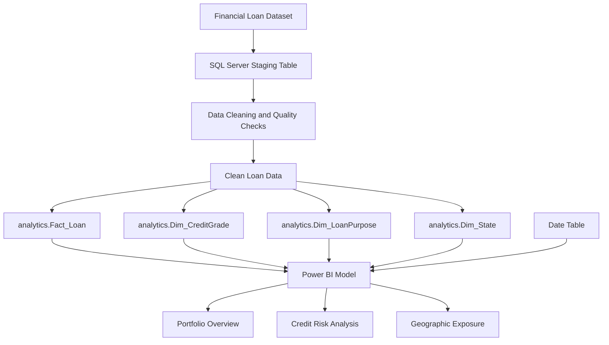

# LendScope
## Loan Portfolio Intelligence & Risk Analytics

LendScope is a loan portfolio analysis project built using **Microsoft SQL Server and Power BI**. I used SQL Server to prepare the loan data, build the analytical tables, and calculate the values required for the analysis. I then used Power BI to explore the portfolio through interactive dashboards.

I organised the report around three business questions:

1. **How healthy is the overall lending portfolio, and where is the bank's capital being deployed?**
2. **Which borrower and loan segments carry the highest charge-off risk, and what financial exposure is associated with those defaults?**
3. **Where is lending geographically concentrated, and are some regions showing disproportionately high charge-off rates?**

The three dashboards answer these questions from different perspectives. The first establishes the portfolio position, the second investigates credit risk and payment patterns, and the third looks at geographic concentration. Slicers and bookmarks allow the analysis to move from the overall portfolio into more specific segments.

---

## Project overview

| Portfolio measure | Result |
|---|---:|
| Loan records | **38,576** |
| Total loan amount (shown as Funded Amount) | **$435.76M** |
| Total recorded payments | **$473.07M** |
| Fully Paid loans | **32,145 (83.33%)** |
| Charged-Off loans | **5,333 (13.82%)** |
| Current loans | **1,098 (2.85%)** |
| Resolved loans (Fully Paid + Charged Off) | **37,478** |
| Resolved-loan charge-off rate | **14.23%** |
| Principal associated with charged-off loans | **$65.53M** |
| Recorded payments associated with charged-off loans | **$37.28M** |
| Payment-to-principal comparison for charged-off loans | **56.90%** |
| Average interest rate | **12.05%** |
| Average DTI shown in the expanded grade matrix | **13.33** |
| Geographic entries represented | **50** |

**Tools used:** SQL Server · T-SQL · Power BI · DAX

---

# 1. Portfolio Overview


## Business question
### How healthy is the overall lending portfolio, and where is the bank's capital being deployed?

I started with an overall view of the loan book. Before looking at risk by grade, purpose, term, or state, I wanted to understand the size of the portfolio, how loans are distributed across their recorded statuses, how much has been recorded as paid, and where most of the original loan amount is concentrated.

### KPI cards

| KPI | Result | What it tells me |
|---|---:|---|
| Total Loans | **38,576** | Number of loan records in the portfolio |
| Funded Amount | **$435.76M** | Total of the original `loan_amount` values |
| Received Amount | **$473.07M** | Total recorded `total_payment` |
| Fully Paid Share | **83.33%** | Share of all loans recorded as Fully Paid |
| Charged-Off Share | **13.82%** | Share of all loans recorded as Charged Off |

### Visual 1 — Loan Status Distribution

**Why I used it:** I wanted one visual that immediately communicates the outcome mix of the portfolio.

**What it shows:** The doughnut chart divides all 38,576 loans into three recorded statuses.

| Loan status | Loan count | Share of all loans | Key finding |
|---|---:|---:|---|
| Fully Paid | 32,145 | **83.33%** | The large majority of the recorded loans have been fully paid. |
| Charged Off | 5,333 | **13.82%** | More than five thousand loans are recorded as charged off, making this a material segment to investigate. |
| Current | 1,098 | **2.85%** | These loans have no final outcome recorded and need to remain separate from both Fully Paid and Charged Off. |

**Finding:** The portfolio is predominantly Fully Paid, but the 5,333 charged-off loans are large enough to justify a separate credit-risk investigation. I kept Current loans as their own category rather than treating them as successful or defaulted outcomes.

### Visual 2 — Funded vs. Received Amount by Loan Status

**Why I used it:** Loan counts show how many accounts fall into each status, but they do not show the amount of money represented by those accounts. I used this comparison to add the financial scale behind the status distribution.

**What it shows:** The clustered bar chart compares the original loan amount with the recorded payments for Fully Paid, Charged Off, and Current loans.

| Loan status | Original loan amount (approx.) | Recorded payments (approx.) | Key finding |
|---|---:|---:|---|
| Fully Paid | **$351M** | **$412M** | Recorded payments exceed original loan amount, which is consistent with payments including interest and other components in addition to principal. |
| Charged Off | **$66M** | **$37M** | A substantial amount of original principal is associated with charged-off accounts, while recorded payments are lower. |
| Current | **$19M** | **$24M** | Payments have been recorded, but the final loan outcome is still unknown. |

**Finding:** The Charged-Off segment represents approximately **$65.53M in original principal** and **$37.28M in recorded payments**. This comparison gives the credit-risk analysis a financial dimension instead of relying only on the number of charge-offs. The values are cumulative recorded payments, not principal-only collections.

### Visual 3 — Monthly Loan Issuance & Amount

**Why I used it:** I wanted to see whether changes in lending volume were being driven by the number of loans, the amount lent, or both.

**What it shows:** The column series represents the total original loan amount by issue month, while the line represents the number of loans issued.

| Element | What it represents | Key finding |
|---|---|---|
| Columns | Total loan amount for each issue month | The monthly loan amount generally increases over the displayed period. |
| Line | Number of loans issued in each month | Loan count also trends upward, so the increase is not only a result of larger loan amounts. |
| Month axis | January to December 2021 | The chart provides a month-by-month view of the lending activity in the available dataset. |

**Finding:** Both the number of loans and the total loan amount generally rise across the year. Looking at the two measures together helps distinguish increased loan issuance from an increase in average loan size. December is a partial month: the latest issue date in the analysed data is **12 December 2021**, so it should not be interpreted as a complete month.

### Visual 4 — Top 5 Loan Purpose by Amount

**Why I used it:** The overall funded amount does not show what borrowers are taking loans for. I used this visual to identify the purposes that account for the largest amounts in the portfolio.

**What it shows:** The chart ranks the five largest loan purposes by total original loan amount.

| Loan purpose | Original loan amount (approx.) | Key finding |
|---|---:|---|
| Debt consolidation | **$232M** | By far the largest lending category and the biggest concentration of original loan amount. |
| Credit card | **$59M** | The second-largest purpose by amount. |
| Home improvement | **$33M** | A meaningful but much smaller exposure than debt consolidation. |
| Small Business | **$24M** | A smaller lending amount than the leading categories, but it becomes important in the credit-risk comparison because of its higher charge-off rate. |
| Major purchase | **$17M** | One of the five largest purposes by original loan amount. |

**Finding:** Debt consolidation dominates the portfolio by amount. However, the purpose with the largest amount is not necessarily the purpose with the highest charge-off rate. That distinction becomes clearer in the Credit Risk Analysis dashboard.

### Loan-purpose labels used in the report

| Purpose | Meaning in the context of the analysis |
|---|---|
| Debt consolidation | A loan used to combine or pay down existing debts into one borrowing arrangement. |
| Credit card | Borrowing associated with paying or refinancing credit-card balances. |
| Home improvement | Borrowing for home repairs, renovation, or improvement work. |
| Small Business | Borrowing for business-related funding needs. |
| Major purchase | Borrowing for a large planned purchase. |
| Car | Borrowing associated with a vehicle purchase or expense. |
| Wedding | Borrowing for wedding-related expenses. |
| Medical | Borrowing for medical or healthcare expenses. |
| House | Borrowing associated with a house-related purpose. |
| Other | A purpose recorded outside the more specific categories listed above. |

### Investigation using the page slicers

After reviewing the four visuals individually, I used the page slicers to narrow the portfolio by **Month, Loan Purpose, State, and Grade**. This makes it possible to check whether the overall portfolio pattern is consistent within a selected group.

For example, Small Business appears as a relatively small category in the Top 5 amount chart. Its importance is not obvious from funding amount alone; the purpose-level charge-off comparison on the next dashboard shows why it deserves a closer look. This is the reason I kept the overview page as the starting point and used the Credit Risk page for the deeper investigation.

---

# 2. Credit Risk Analysis

The Credit Risk Analysis page has two views: **Risk** and **Payments**. I used bookmarks to switch between them without creating separate report pages. The Risk view focuses on the distribution and rate of charge-offs. The Payments view compares the original principal associated with charged-off loans with the recorded payments on those accounts.

## Business question
### Which borrower and loan segments carry the highest charge-off risk, and what financial exposure is associated with those defaults?

## 2.1 Risk view


### KPI cards

| KPI | Result | What it tells me |
|---|---:|---|
| Resolved Loan | **37,478** | Fully Paid plus Charged-Off loans |
| Charge-Offs | **5,333** | Number of loans recorded as Charged Off |
| CO Principal | **$65.53M** | Original principal associated with Charged-Off loans |
| CO Received | **$37.28M** | Recorded payments associated with Charged-Off loans |
| Payment % | **56.90%** | CO Received compared with CO Principal |
| Charged-Off Rate | **14.23%** | Charge-Offs as a share of resolved loans |

### Visual 1 — Funded Exposure & Charge-Off Rate by Grade

**Why I used it:** The dataset already contains a credit-grade system from A to G. I wanted to see whether the loan outcomes differ across those existing risk categories and whether the amount of lending is concentrated in the same grades that have the highest charge-off rates.

**What it shows:** The columns compare original loan amount by grade; the line compares the displayed charge-off rate.

| Grade | Original loan amount (approx.) | Charge-Off rate | Key finding |
|---|---:|---:|---|
| A | **$84M** | **5.72%** | Lowest observed charge-off rate in the grade comparison. |
| B | **$131M** | **11.84%** | Largest original loan amount, with a materially lower charge-off rate than the weaker grades. |
| C | **$87M** | **16.56%** | High lending exposure and a higher charge-off rate than A and B. |
| D | **$64M** | **21.59%** | Charge-off rate continues to rise as the grade weakens. |
| E | **$44M** | **26.46%** | More than one-quarter of the resolved loans in this grade are charged off, based on the displayed rate. |
| F | **$19M** | **32.50%** | High charge-off rate, despite a smaller amount of lending. |
| G | **$6M** | **33.11%** | Highest displayed grade-level charge-off rate, with the smallest lending exposure. |

**Findings:**

- The displayed charge-off rate generally increases from Grade A to Grade G. The weaker grades show a larger proportion of charged-off loans.
- Grade B carries the largest original loan amount, approximately **$131M**, but does not have the highest charge-off rate. This separates lending concentration from credit risk.
- Grades F and G have the highest charge-off rates, but their original loan amounts are much smaller than those of Grades B and C.
- Grade C is also important because it combines a sizeable loan amount with a charge-off rate above that of A and B.

The dataset already has an **A–G credit grading and sub-grade structure**. The analysis uses that existing classification rather than creating a new scoring system. The interest-rate values in the grade detail also generally increase towards weaker grades. This is consistent with risk-based pricing already being reflected in the loan records: the existing grade is associated with different interest rates. I used the analysis to examine how recorded outcomes vary across those grades and rates.

### Visual 2 — Grade Risk Matrix

**Why I used it:** The chart gives a quick comparison, but it does not provide enough detail to compare the exact number of loans and the amount associated with charge-offs. I used the matrix to make those values available alongside the rate.

**What it shows:** The matrix provides grade-level loan count, original loan amount, charge-off count, charged-off principal, and charge-off rate. The total row provides the overall figure for the same measures.

| Grade | Total loans | Charge-Offs | CO Principal (approx.) | Charge-Off rate | Key finding |
|---|---:|---:|---:|---:|---|
| A | 9,689 | 552 | **$4.44M** | **5.72%** | Large loan count but the lowest grade-level rate. |
| B | 11,674 | 1,343 | **$14.90M** | **11.84%** | Largest loan count, largest original exposure, and largest CO Principal. |
| C | 7,904 | 1,266 | **$14.16M** | **16.56%** | Second-largest charge-off count and a large CO Principal. |
| D | 5,182 | 1,072 | **$13.22M** | **21.59%** | More than one thousand charge-offs and a high rate. |
| E | 2,786 | 691 | **$10.99M** | **26.46%** | Lower loan volume but a higher rate and material principal exposure. |
| F | 1,028 | 311 | **$6.00M** | **32.50%** | High rate in a much smaller grade segment. |
| G | 313 | 98 | **$1.83M** | **33.11%** | Highest rate, but the smallest loan count and CO Principal. |

**Findings:**

- Grade B has the largest CO Principal at approximately **$14.90M**, followed by Grade C at approximately **$14.16M**. These grades deserve attention because of the amount of principal associated with their charge-offs.
- Grade G has the highest percentage, but only 98 charge-offs. It would be misleading to rank the financial impact using the percentage alone.
- Grade D and Grade E combine elevated charge-off rates with meaningful principal exposure.
- The matrix supports a more balanced review: the rate indicates how frequently charge-offs occur within the segment, while the count and principal indicate the scale of the segment.

#### Expanded Grade and Sub-Grade matrix

The matrix can be expanded from **Grade** to **Sub Grade**. This takes the analysis from the seven main grades into the more detailed sub-grade categories, such as A1–A5, B1–B5, and so on.

The expanded view includes the loan count, funded amount, Fully Paid count, Charge-Off count, CO Principal, CO Received, average interest rate, average DTI, Payment %, and Charged-Off Rate.

**Why the expansion matters:** A grade-level average can hide differences within the same grade. Looking at A1–A5 or B1–B5 makes it possible to see whether charge-off rates, interest rates, and payment comparisons vary across the sub-grades.

**Finding:** The sub-grade view shows a more detailed risk gradient within the main grade categories. It also places average interest rate and DTI beside the loan outcomes, making it easier to examine how the existing borrower-risk classification and pricing pattern relate to the observed charge-offs. The values should be read at sub-grade level rather than assumed to be identical for every loan within a main grade.

### Visual 3 — Funded Exposure & Charge-Off Rate by Purpose

**Why I used it:** Credit grade is only one way to segment the loan book. I also wanted to understand whether the reason for borrowing is associated with different charge-off outcomes.

**What it shows:** The columns compare original loan amount by loan purpose and the line shows the displayed charge-off rate.

| Loan purpose | Original loan amount (approx.) | Charge-Off rate | Key finding |
|---|---:|---:|---|
| Debt consolidation | **$232M** | **15.0%** | Largest lending exposure, with a moderate charge-off rate relative to Small Business. |
| Credit card | **$59M** | **10.4%** | Second-largest exposure and a lower displayed rate than Debt consolidation. |
| Home improvement | **$33M** | **11.8%** | Moderate exposure and a relatively lower rate. |
| Other | **$31M** | **15.8%** | Smaller exposure than the leading purposes, with a higher rate than several categories. |
| Small Business | **$24M** | **26.7%** | Highest displayed purpose-level charge-off rate. |
| Major purchase | **$17M** | **9.9%** | Lower displayed charge-off rate. |
| Car | **$10M** | **10.7%** | Lower rate compared with the higher-risk purpose categories. |
| Wedding | **$9M** | **9.5%** | Lowest displayed rate among the purposes in this chart. |
| Medical | **$6M** | **15.3%** | Smallest amount among the displayed categories, with a higher rate than several larger categories. |

**Findings:**

- **Debt consolidation has the largest amount of lending at approximately $232M**, but its charge-off rate is around 15.0%, well below Small Business.
- **Small Business has the highest displayed charge-off rate at 26.7%**, even though its original loan amount is approximately $24M. It is a good example of why the largest purpose by amount is not automatically the highest-risk purpose.
- Other and Medical also show elevated rates compared with several of the other purposes.
- Credit card, Major purchase, Car, and Wedding have lower displayed rates in this comparison.

### Visual 4 — Loan Status & Charge-Off Rate by Term

**Why I used it:** Loan duration is another important part of the lending structure. I used this visual to compare how the recorded loan outcomes differ between 36-month and 60-month terms.

**What it shows:** The columns show the loan-status amounts for the two terms, while the line compares the charge-off rate.

| Loan term | Resolved loans | Charge-Offs | Resolved charge-off rate | Key finding |
|---|---:|---:|---:|---|
| 36 months | **28,237** | **3,023** | **10.7%** | Lower observed charge-off rate across the resolved loans. |
| 60 months | **9,241** | **2,310** | **25.0%** | Much higher observed rate, despite having fewer resolved loans. |

**Findings:**

- The 60-month group has a **25.0% resolved charge-off rate**, compared with **10.7%** for 36-month loans.
- The 60-month segment has fewer resolved loans, but its charge-off count is still substantial at 2,310.
- All **1,098 Current loans** in this dataset are in the 60-month group. This is important when reading the term comparison because those loans have not yet reached a recorded final outcome.
- The difference is an observed pattern in this dataset. The chart does not establish that choosing a longer term causes a loan to be charged off.

## 2.2 Payments view


### What I wanted to investigate

After identifying which segments have higher charge-off rates, I wanted to examine the amount associated with those charged-off accounts. The Payments view compares **CO Principal** with **CO Received** and calculates Payment % for each grade, purpose, and term.

Payment % is calculated as:

`CO Received / CO Principal × 100`

It is a comparison of cumulative recorded payments with original principal for charged-off loans. It should not be interpreted as a formal post-charge-off recovery rate because `total_payment` is cumulative and may include payments made before charge-off, interest, and fees.

### Visual 1 — Credit Grade Exposure & Payment Performance

**Why I used it:** The Risk view shows which grades have higher charge-off rates. I used this chart to see how the recorded payment-to-principal comparison varies across those same grades.

**What it shows:** The columns compare CO Principal and CO Received by grade, while the line represents Payment %.

| Grade | Payment % | Key finding |
|---|---:|---|
| A | **56.2%** | Recorded payments are a little over half of CO Principal. |
| B | **55.3%** | Large charged-off exposure, with a payment percentage below the portfolio's 56.90%. |
| C | **56.2%** | Similar payment percentage to Grade A. |
| D | **56.9%** | Around the portfolio-level comparison. |
| E | **58.8%** | Higher Payment % than A–D. |
| F | **60.4%** | Highest Payment % among the grades in this visual. |
| G | **53.7%** | Lowest Payment % among the grades in this visual. |

**Findings:**

- Grades B and C carry large CO Principal amounts, so their payment comparisons matter in absolute terms as well as percentages.
- Grade F has the highest Payment % at **60.4%**, while Grade G has the lowest at **53.7%**.
- The grade with the highest charge-off rate is not automatically the grade with the lowest Payment %. Risk and payment performance are related views, but they measure different things.
- Comparing the two bars and the percentage line makes it possible to distinguish the amount associated with charge-offs from the relative recorded-payment comparison.

### Visual 2 — Loan Purpose Exposure & Payment Performance

**Why I used it:** The purpose risk chart identifies Small Business as a high charge-off-rate category. I used this visual to compare the payment-to-principal percentage across purposes and see whether the amount comparison tells a similar story.

**What it shows:** The columns compare CO Principal and CO Received by purpose; the line represents Payment %.

| Loan purpose | Payment % | Key finding |
|---|---:|---|
| Debt consolidation | **58.1%** | Largest charged-off principal exposure among the purposes, with a payment percentage above Small Business. |
| Credit card | **60.5%** | Higher Payment % than most of the displayed purposes. |
| Small Business | **50.4%** | Lowest Payment % among the displayed purposes. |
| Other | **54.0%** | Below the overall 56.90% comparison. |
| Home improvement | **53.0%** | One of the lower payment percentages. |
| Major purchase | **54.5%** | Below the portfolio-level comparison. |
| Car | **65.6%** | Highest Payment % in this purpose comparison, although its charged-off principal is much smaller than Debt consolidation. |
| Wedding | **58.1%** | Above the portfolio-level comparison. |
| Medical | **52.3%** | One of the lowest payment percentages. |

**Findings:**

- **Small Business has the lowest Payment % at 50.4%** in the all-term purpose comparison. This is consistent with it being a segment that needs attention in the Risk view, where it also has the highest displayed charge-off rate.
- Debt consolidation has the largest CO Principal exposure, so its payment percentage is important even though its charge-off rate is not the highest.
- Car has the highest Payment % at **65.6%**, but the amount associated with its charged-off loans is comparatively small. A high percentage does not necessarily mean the largest amount is being paid.
- Small Business stands out for the combination of a high charge-off rate and a low Payment %.

### Visual 3 — Loan Term Exposure & Payment Performance

**Why I used it:** The Risk view shows a much higher charge-off rate for 60-month loans. I used the Payments view to compare the recorded payment-to-principal percentage for the same two terms.

**What it shows:** The columns compare CO Principal and CO Received for 60-month and 36-month charged-off loans, while the line shows Payment %.

| Loan term | CO Principal (approx.) | CO Received (approx.) | Payment % | Key finding |
|---|---:|---:|---:|---|
| 60 months | **$36.62M** | **$20.70M** | **56.53%** | Larger charged-off principal exposure and a slightly lower Payment % than 36 months. |
| 36 months | **$28.91M** | **$16.58M** | **57.35%** | Lower CO Principal and a slightly higher Payment %. |

**Findings:**

- The 60-month group has a higher CO Principal amount than the 36-month group.
- Its Payment % is **56.53%**, slightly below the 36-month figure of **57.35%**.
- The difference in Payment % is smaller than the difference in the resolved charge-off rates. This shows why the risk view and payment view should be read together rather than treated as the same measure.
- The 60-month group is important because it combines a higher observed charge-off rate with a larger charged-off principal amount.

### Investigation using the Credit Risk slicers

After reviewing the individual charts, I used the **Loan Term** slicer to focus on 60-month loans. I then compared the grade and purpose results and switched to the Payments bookmark to examine the payment pattern for the same segment.

#### 60-month term: the filtered portfolio

| Filtered KPI | Result |
|---|---:|
| Resolved loans | **9,241** |
| Charge-Offs | **2,310** |
| CO Principal | **$36.62M** |
| CO Received | **$20.70M** |
| Payment % | **56.53%** |
| Resolved Charged-Off Rate | **25.00%** |

#### What changes across grades?

| Grade | Filtered loan count | Charge-Offs | Charge-Off rate | Key finding |
|---|---:|---:|---:|---|
| A | 415 | 35 | **9.21%** | Lowest rate in the filtered grade comparison. |
| B | 2,599 | 421 | **18.53%** | Largest filtered loan count and a sizeable charged-off count. |
| C | 2,291 | 479 | **23.55%** | High number of charge-offs and a higher rate than A and B. |
| D | 2,022 | 518 | **28.68%** | High charge-off count and elevated rate. |
| E | 1,933 | 523 | **29.75%** | Largest charge-off count in the filtered grade matrix. |
| F | 822 | 257 | **34.22%** | Highest filtered grade-level charge-off rate. |
| G | 257 | 77 | **32.08%** | Second-highest rate, with a smaller loan count. |

**Filtered grade finding:** Under the 60-month filter, the charge-off rate rises from **9.21% in Grade A** to **34.22% in Grade F**. Grades D, E, F, and G have particularly elevated rates. Grade E has the largest charge-off count (523), while Grade F has the highest rate (34.22%). This distinction between count and rate is important when interpreting the table.

#### What changes across loan purposes?

| Loan purpose | Original loan amount (approx.) | Charge-Off rate | Key finding |
|---|---:|---:|---|
| Debt consolidation | **$93M** | **26.1%** | Largest 60-month exposure by amount, with a high charge-off rate. |
| Credit card | **$17M** | **23.2%** | Smaller exposure than Debt consolidation, with an elevated rate. |
| Home improvement | **$14M** | **17.6%** | Lower rate than several other purposes in this filtered view. |
| Small Business | **$10M** | **39.6%** | Highest charge-off rate among the displayed purposes. |
| Other | **$10M** | **29.4%** | Also shows a high rate in the filtered portfolio. |
| Major purchase | **$5M** | **20.0%** | Lower than the highest-risk purpose categories. |
| Car | **$4M** | **15.4%** | Lowest displayed rate in this filtered comparison. |
| Wedding | **$3M** | **17.9%** | Lower rate than Small Business and Other. |
| House | **$2M** | **28.6%** | High rate, but a small amount of lending in this filtered group. |

**Filtered purpose finding:** Small Business becomes the clearest high-risk purpose under the 60-month filter. Its charge-off rate reaches **39.6%**, compared with **26.1%** for Debt consolidation. Debt consolidation still represents the largest amount of lending in this segment (approximately $93M), but Small Business has the highest rate despite a much smaller amount (approximately $10M).

#### What changes in the Payments view?

When I carry the 60-month filter into the Payments bookmark, Small Business remains the purpose that needs the closest attention: it combines the highest charge-off rate in the filtered purpose comparison with the weakest Payment % among the purpose groups in that filtered view.

This is a more specific finding than looking at Small Business or 60-month loans separately. The combination of **60-month term + Small Business purpose + lower-to-middle credit grades** identifies a segment with a high observed charge-off rate and comparatively weak recorded payments against charged-off principal.

---

# 3. Geographic Exposure


## Business question
### Where is lending geographically concentrated, and are some regions showing disproportionately high charge-off rates?

I used the Geographic Exposure page to compare the size of each state's loan book with its charge-off outcomes. The map shows where lending is concentrated, the Top 10 chart compares the largest state portfolios, and the matrix and scatter plot add the state-level detail needed to distinguish volume from risk.

### KPI cards

| KPI | Result | What it tells me |
|---|---:|---|
| Total States | **50** | Geographic entries represented, including the District of Columbia |
| Total Loans | **38,576** | Total loan records |
| Funded Amount | **$435.76M** | Total original loan amount |
| Charged-Off Rate | **14.23%** | Charge-offs divided by resolved loans |

### Visual 1 — Loan Amount by State

**Why I used it:** I wanted a geographic view of the portfolio before comparing state-level risk. The map makes it easier to see how unevenly the original loan amount is distributed across the United States.

**What it shows:** A filled map in which the state shading represents the original loan amount associated with that state.

| What I observe | Key finding |
|---|---|
| State shading | Lending exposure is not distributed evenly across the map. |
| Largest market | California has the highest original loan amount in the overall portfolio. |
| Purpose of the map | It identifies lending concentration; it does not by itself show which state has the highest charge-off rate. |

**Finding:** California is the largest lending market by original loan amount. I used the map as a concentration view, then used the Top 10 chart, State Risk Matrix, and scatter plot to investigate risk separately.

### Visual 2 — Top 10 States by Loan Amount

**Why I used it:** The map shows geographic concentration visually, but it is difficult to compare exact state rankings and charge-off percentages from shading alone. I used this chart to rank the ten largest state portfolios and compare their resolved-loan charge-off rates.

**What it shows:** Columns rank states by original loan amount; the line displays **Charged-Off Rate**.

**How to read the percentage:** For this chart, **Charged-Off Rate = Charged-Off loans ÷ Resolved loans × 100**, where Resolved loans are Fully Paid + Charged Off. Loans with a Current status are excluded because they do not yet have a final recorded outcome. The Top 10 chart uses the same resolved-loan definition as the State Risk Matrix. For example, California's 1,057 charged-off loans produce a rate of **15.66%** when divided by its resolved-loan count.

| State | Original loan amount (approx.) | Charged-Off Rate | Key finding |
|---|---:|---:|---|
| California | **$78.48M** | **15.66%** | Largest state exposure; its resolved-loan charge-off rate is above the portfolio rate of 14.23%. |
| New York | **$42.08M** | **13.03%** | Second-largest exposure, with a rate below the portfolio figure. |
| Texas | **$31.24M** | **11.59%** | Large exposure with a comparatively lower resolved-loan rate. |
| Florida | **$30.05M** | **17.80%** | Similar exposure to Texas but a higher resolved-loan rate. |
| New Jersey | **$21.66M** | **15.47%** | Smaller exposure than the leading four states, with a rate above the portfolio figure. |
| Illinois | **$17.12M** | **13.33%** | Moderate exposure and a rate below the portfolio figure. |
| Virginia | **$15.98M** | **12.72%** | Moderate exposure with a rate below the portfolio figure. |
| Pennsylvania | **$15.83M** | **11.77%** | Lower resolved-loan rate among the top-ten states. |
| Georgia | **$15.48M** | **15.72%** | Smaller exposure than the largest markets, with a rate above the portfolio figure. |
| Massachusetts | **$15M approx.** | See chart label | Included among the ten largest state portfolios; its resolved-loan rate is displayed by the chart line. |

**Findings:**

- California has the largest exposure at approximately **$78.48M** across **6,894 loans**. Its **15.66%** resolved-loan charge-off rate is above the portfolio rate of **14.23%**.
- California, New York, and Texas together account for approximately **$151.8M**, or around **34.8%** of the total original loan amount.
- Florida has a similar original loan amount to Texas, but its resolved-loan charge-off rate is higher (**17.80% versus 11.59%**). This is a useful example of why funding rank alone is not enough to understand risk.
- New Jersey (**15.47%**) and Georgia (**15.72%**) also exceed the portfolio's **14.23%** resolved-loan rate, while New York, Texas, Illinois, Virginia, and Pennsylvania are below it.
- The top-ten comparison shows that the largest market is not automatically the market with the highest charge-off rate.

### Visual 3 — State Risk Matrix

**Why I used it:** A chart helps identify patterns, but the state risk matrix gives the exact loan counts, amounts, and charge-offs behind those patterns. It allows state comparisons to be made using both the rate and the scale of exposure.

**What it shows:** The compact matrix displays State Name, Total Loans, Funded Amount, Charge-Offs, CO Principal, and Charged-Off Rate. In the expanded table presentation, the additional state-level fields include Fully Paid loans, CO Received, and Payment %, so the viewer can compare the number of completed loans and the recorded payment-to-principal relationship as well as the charge-off exposure.

**How to read the percentage:** The matrix uses **Charged-Off Rate = Charged-Off loans ÷ Resolved loans × 100**, where Resolved loans are Fully Paid + Charged Off. Current loans are excluded because they do not have a final outcome. The Top 10 chart uses this same definition, so the state-level rates are consistent across both visuals.

Selected rows from the overall state matrix:

| State | Total loans | Funded amount | Charge-Offs | CO Principal | Charged-Off Rate | Key finding |
|---|---:|---:|---:|---:|---:|---|
| California | 6,894 | **$78.48M** | 1,057 | **$13.12M** | **15.66%** | Largest state exposure and the largest CO Principal in the displayed matrix. |
| Florida | 2,773 | **$30.05M** | 479 | **$5.65M** | **17.80%** | Higher rate than California despite a much smaller loan book. |
| New York | 3,701 | **$42.08M** | 468 | **$5.84M** | **13.03%** | Second-largest exposure, with a lower rate than California and Florida. |
| Texas | 2,664 | **$31.24M** | 301 | **$3.79M** | **11.59%** | Large market with a comparatively lower rate in this table. |
| New Jersey | 1,822 | **$21.66M** | 273 | **$3.46M** | **15.47%** | Smaller exposure than the leading states, with a rate above the overall figure. |
| Georgia | 1,355 | **$15.48M** | 207 | **$2.41M** | **15.72%** | Moderate exposure and a rate above the overall figure. |

**Findings:**

- California has the largest loan count, original loan amount, charge-off count, and CO Principal in the selected state rows. Its importance comes from scale as well as its charge-off rate.
- Florida's charge-off rate (**17.80%**) is higher than California's (**15.66%**), even though Florida has less than half of California's loan count.
- Texas has more than $31M in original loan amount but a lower displayed rate (**11.59%**) than California and Florida.
- New Jersey and Georgia also have rates above the portfolio's 14.23% resolved-loan rate.
- The matrix makes the distinction between exposure and risk concrete: the largest principal amount can belong to one state, while another state can have the higher percentage.

The matrix includes a total row so the state-level figures can be compared with the portfolio. The total percentage is recalculated from the total counts and is not the sum or simple average of the state percentages.

### Visual 4 — State Risk Segmentation: Loan Count vs. Charged-Off Rate

**Why I used it:** I wanted to distinguish states with many loans from states with a high Charged-Off Rate. The matrix provides exact figures, while the scatter plot makes the relationship between loan volume and the resolved-loan charge-off rate easier to see across all represented geographies.

**What it shows:**
- **X-axis:** Total loan count in the state.
- **Y-axis:** Charged-Off Rate.
- **Bubble size:** Original loan amount, showing the relative size of state exposure.
- **Colour:** Risk category used in the report.

| Scatter-plot pattern | Key finding |
|---|---|
| Points further to the right | States with larger loan counts. |
| Points higher on the chart | States with higher Charged-Off Rate. |
| Larger bubbles | States with greater original loan amount. |
| States with high values on both axes | Geographic segments that combine loan volume with a higher observed charge-off rate and deserve closer review. |

**Finding:** The plot shows that a high loan count does not automatically mean a high charge-off rate. It also makes it possible to notice states with smaller loan books but relatively high rates. Reading the position, size, and colour together gives a more complete picture than ranking states by funded amount alone.

### Investigation using the Geographic Exposure slicers

After reviewing the overall map, Top 10 chart, matrix, and scatter plot, I used the **Loan Term** slicer to investigate where the higher charge-off pattern for 60-month loans is concentrated.

#### 60-month geographic portfolio

| Filtered KPI | Result |
|---|---:|
| Geographic entries | **50** |
| Total loans | **10,339** |
| Original loan amount | **$162.72M** |
| Charge-Offs | **2,310** |
| CO Principal | **$36.62M** |
| Resolved charge-off rate | **25.00%** |

#### Top state exposures under the 60-month filter

| State | Loan count | Original loan amount (approx.) | Charged-Off Rate in Top 10 chart | Key finding |
|---|---:|---:|---:|---|
| California | 1,684 | **$26.36M** | **27.00%** | Largest 60-month state exposure and loan count. |
| New York | 940 | **$14.70M** | **24.70%** | Second-largest exposure in this filtered comparison. |
| Texas | 662 | **$11.05M** | **21.18%** | Lower rate than California and New York in the filtered matrix. |
| Florida | 714 | **$11.00M** | **31.01%** | Similar exposure to Texas but a much higher resolved-loan rate. |
| New Jersey | 503 | **$8.32M** | **26.46%** | Elevated resolved-loan rate in the filtered segment. |
| Georgia | 392 | **$6.43M** | **21.75%** | Smaller exposure and a lower rate than several states above it. |
| Virginia | 380 | **$6.32M** | **23.68%** | Smaller state portfolio with a rate above 20%. |
| Illinois | 385 | **$6.14M** | **24.78%** | Similar exposure to Pennsylvania and a higher rate in the matrix. |
| Pennsylvania | 413 | **$6.14M** | **22.89%** | More loans than Illinois in this filtered view, with a slightly lower rate. |
| Ohio | — | **Approx. $5.6M** | See chart label | Included among the ten largest state exposures in the filtered chart; its resolved-loan rate is displayed by the chart line. |

#### What does the filtered State Risk Matrix show?

The 60-month Top 10 chart and State Risk Matrix both use **Charged-Off Rate = Charged-Off loans ÷ Resolved loans × 100**, where Resolved loans are Fully Paid + Charged Off. Current loans are excluded. The rate values below are taken from the filtered State Risk Matrix; the Top 10 chart displays the same measure.

| State | Loan count | Original loan amount | Charge-Offs | CO Principal | Matrix Charged-Off Rate | Key finding |
|---|---:|---:|---:|---:|---:|---|
| California | 1,684 | **$26.36M** | 416 | **$6.79M** | **27.00%** | Largest filtered state exposure and a high resolved charge-off rate. |
| New York | 940 | **$14.70M** | 205 | **$3.16M** | **24.70%** | Second-largest exposure, with a rate close to the filtered portfolio pattern. |
| Florida | 714 | **$11.00M** | 196 | **$2.99M** | **31.01%** | Higher matrix rate than California despite having fewer than half as many loans. |
| Texas | 662 | **$11.05M** | 126 | **$2.03M** | **21.18%** | Similar exposure to Florida but a lower matrix rate. |
| New Jersey | 503 | **$8.32M** | 118 | **$1.97M** | **26.46%** | Smaller portfolio with a high resolved charge-off rate. |
| Illinois | 385 | **$6.14M** | 84 | **$1.34M** | **24.78%** | Smaller loan count, but a rate close to New York. |
| Pennsylvania | 413 | **$6.14M** | 84 | **$1.28M** | **22.89%** | Similar exposure to Illinois with a lower rate. |
| Virginia | 380 | **$6.32M** | 81 | **$1.42M** | **23.68%** | A smaller state portfolio with a rate below the filtered overall rate. |
| Georgia | 392 | **$6.43M** | 77 | **$1.18M** | **21.75%** | Similar loan count to Virginia, with a lower matrix rate. |

**Filtered geographic findings:**

- California remains the largest 60-month state portfolio, with approximately **$26.36M** across **1,684 loans**.
- Florida has the highest matrix Charged-Off Rate among the states shown in this expanded view (**31.01%**), while California has the largest exposure and charge-off count.
- Texas has a similar original loan amount to Florida but a lower matrix rate (**21.18% versus 31.01%**).
- New Jersey also has a high matrix rate (**26.46%**) despite a smaller state portfolio.
- In the 60-month scatter plot, many state markers move into the red/high-risk category. The higher charge-off pattern is therefore visible across multiple states in this filtered segment, rather than being limited to one large state.
- The matrix and scatter plot provide two views of the same investigation: the matrix gives the state figures, while the scatter plot makes the broader state pattern easier to identify.

The Top 10 chart and State Risk Matrix use the same **Charged-Off Rate** definition and resolved-loan denominator. This keeps the geographic risk comparison consistent across the two visuals.

This filter-based investigation connects the term-level finding from Credit Risk Analysis with the geographic view. It shows where the 60-month portfolio is located and which state segments combine loan volume with a higher observed resolved-loan charge-off rate.

---

# 4. SQL Server work

I used SQL Server for the data preparation, table creation, analysis, and validation behind the report. The objective was to calculate the values at the same level as the dashboard visuals so that the KPI cards, charts, and matrices could be checked against SQL results.

## Data preparation

The SQL workflow covers:

- Database creation and source-data import into a staging table.
- Inspection of columns and data types.
- Checks for missing and blank values.
- Duplicate loan ID checks.
- Checks for invalid or negative numeric values and unexpected loan statuses.
- Data cleaning, type conversion, and standardisation.
- Creation of dimension tables and the central fact table.
- Validation of dimension keys and fact-to-dimension matches.

## Data model

The central table is `analytics.Fact_Loan`, with one row per loan. Credit grade, loan purpose, and state are stored in separate dimension tables.

| Table | Role | Main attributes |
|---|---|---|
| `analytics.Fact_Loan` | Loan-level fact table | Loan ID, loan amount, total payment, status, term, issue date, interest rate, DTI, and dimension keys |
| `analytics.Dim_CreditGrade` | Credit-grade dimension | Grade and sub-grade |
| `analytics.Dim_LoanPurpose` | Loan-purpose dimension | Purpose category |
| `analytics.Dim_State` | Geographic dimension | State code and full state name |
| Date table in Power BI | Date dimension | Calendar attributes for issue-date filtering and monthly analysis |



## SQL concepts used

| SQL concept | Application in the project |
|---|---|
| `SELECT`, `WHERE`, `ORDER BY` | Inspecting, filtering, and sorting loan records |
| Aggregate functions | Calculating counts, loan amounts, payments, averages, and percentages |
| `CASE WHEN` | Separating Fully Paid, Charged Off, and Current loan outcomes |
| `JOIN` | Bringing grade, purpose, and state attributes into the fact-table analysis |
| `GROUP BY` | Aggregating results by grade, sub-grade, purpose, term, month, and state |
| CTEs | Structuring multi-step analysis where an intermediate result is useful |
| Window functions | Supporting ranking and partition-based calculations |
| `GROUPING SETS` | Producing grade and sub-grade levels in the expanded risk matrix |
| Date functions | Grouping issue dates into monthly lending activity |
| `CAST` and `NULLIF` | Controlling numeric precision and preventing division-by-zero errors |
| `UNION ALL` | Appending calculated total rows to grouped matrix results where required |

## SQL scripts

The scripts are stored in the `SQL Scripts/` folder and follow this workflow:

| Script | Purpose |
|---|---|
| `01_Database creation and data import.sql` | Creates the database and prepares the source-data import. |
| `02_Data Cleaning and Transformation.sql` | Profiles, cleans, and transforms the source loan data. |
| `03_Dimension and Fact Table Creation.sql` | Creates the credit-grade, loan-purpose, and state dimensions and the loan fact table. |
| `04_Dashboard 1 Portfolio Overview KPI Validation and Analysis.sql` | Recalculates and validates the Portfolio Overview KPIs and chart values. |
| `05_Dashboard 2 Part 1 Risk KPI Validation and Analysis.sql` | Recalculates and validates the Credit Risk KPIs and risk visuals. |
| `06_Dashboard 2 Part 2 Payment Validation and analysis.sql` | Recalculates and validates CO Principal, CO Received, and Payment % by grade, purpose, and term. |
| `07_Dashboard 3 Geographic Exposure Kpi Validation and Analysis.sql` | Recalculates and validates geographic KPIs, state-level values, and the values behind the geographic visuals. |

---

# 5. Power BI features

The report includes interactive elements to make the analysis easier to explore:

- **Slicers:** Month, Grade, Loan Purpose, Loan Term, and State, depending on the dashboard page.
- **Risk and Payments bookmarks:** Switch between the two Credit Risk views without navigating to a separate report page.
- **Chart and table view switching:** Bookmarks provide alternate visual and tabular presentations where configured.
- **Expandable Grade Risk Matrix:** Expand Grade into Sub Grade to examine the detailed categories beneath A–G.
- **Expanded table views:** The grade and state matrices provide a more detailed view of the values behind the visuals.
- **Cross-filtering:** Selecting a segment allows the other visuals to be examined within the same filter context.

---

# 6. Data source

The project uses the **Financial Loan Dataset** published on Kaggle.

- **Dataset:** [Financial Loan Dataset — Kaggle](https://www.kaggle.com/datasets/datawitharyan/financial-loan-dataset)
- **Publisher shown on Kaggle:** DataWithAryan
- **Underlying records:** LendingClub loan records, as described on the dataset page.
- **Period analysed:** 2021 issue-date records.
- **Latest issue date in the analysed fact table:** 12 December 2021.
- **Geography:** United States.

The source dataset includes loan and borrower attributes such as loan amount, total payment, loan status, issue date, credit grade, sub-grade, loan purpose, loan term, state, interest rate, and DTI.

---

# 7. Metric definitions

| Metric | Definition used |
|---|---|
| Total Loans | Count of distinct loan IDs |
| Funded Amount | Sum of `loan_amount` in the fact table |
| Received Amount | Sum of `total_payment` |
| Fully Paid Share | Fully Paid loans ÷ all loans × 100 |
| Charged-Off Share (Portfolio Overview) | Charged-Off loans ÷ all loans × 100; includes Current loans in the denominator |
| Resolved Loans | Fully Paid loans + Charged-Off loans; excludes Current loans |
| Charged-Off Rate (Credit Risk and Geographic Exposure) | Charged-Off loans ÷ resolved loans × 100; excludes Current loans |
| CO Principal | Sum of `loan_amount` for Charged-Off loans |
| CO Received | Sum of `total_payment` for Charged-Off loans |
| Payment % | CO Received ÷ CO Principal × 100 |
| Average Interest Rate | Average of `int_rate`, displayed as a percentage |
| Average DTI | Average of `dti` in the stored scale |
| Total States | Distinct geographic keys represented in the data |

**Rate definitions matter.** The Portfolio Overview's **13.82% Charged-Off Share** uses all loans as the denominator and includes Current loans. In contrast, the Credit Risk and Geographic Exposure dashboards use **Charged-Off Rate = Charged-Off loans ÷ Resolved loans × 100**, where Resolved loans are Fully Paid + Charged Off and Current loans are excluded. The Geographic Exposure Top 10 chart, State Risk Matrix, and state scatter plot all use this same resolved-loan definition. The overall resolved-loan charge-off rate is **14.23%**. For example, California's state-level rate is **15.66%** in both the Top 10 chart and State Risk Matrix.

**Funded Amount naming:** The report's Funded Amount is calculated from `SUM(loan_amount)`, because the analytical fact table uses `loan_amount` and does not contain a separate `funded_amount` field.

**Payment % interpretation:** CO Received is the cumulative `total_payment` associated with charged-off loans. It is not limited to payments made after charge-off. Payment % is therefore a recorded-payment-to-original-principal comparison, not a formal post-charge-off recovery rate or realised net loss.

---

# 8. Repository structure

```text
LendScope - Loan Portfolio Intelligence & Risk Analytics/
│
├── PowerBI/
│   └── Loan Portfolio Intelligence & Risk Analytics.pbix
│
├── Raw Dataset/
│
├── Screenshots/
│   ├── Dashboard 1 Portfolio Overview.png
│   ├── Dashboard 2 Part 1 Risk Analytics.png
│   ├── Dashboard 2 part 2 CO Percentage Received.png
│   └── Dashboard 3 Geographic Exposure.png
│
├── SQL Scripts/
│   ├── 01_Database creation and data import.sql
│   ├── 02_Data Cleaning and Transformation.sql
│   ├── 03_Dimension and Fact Table Creation.sql
│   ├── 04_Dashboard 1 Portfolio Overview KPI Validation and Analysis.sql
│   ├── 05_Dashboard 2 Part 1 Risk KPI Validation and Analysis.sql
│   ├── 06_Dashboard 2 Part 2 Payment Validation and analysis.sql
│   └── 07_Dashboard 3 Geographic Exposure Kpi Validation and Analysis.sql
│
└── README.md
```

---

# 9. Running the project

### Requirements
- Microsoft SQL Server
- SQL Server Management Studio (SSMS)
- Power BI Desktop

### Execution order

1. Download the [Financial Loan Dataset from Kaggle](https://www.kaggle.com/datasets/datawitharyan/financial-loan-dataset).
2. Create the `BankLoanAnalytics` database and import the source file into the staging table.
3. Run the data-cleaning and transformation script.
4. Run the dimension and fact table creation script.
5. Run the seven SQL scripts in their numbered order.
6. Open `Loan Portfolio Intelligence & Risk Analytics.pbix` from the `PowerBI` folder.
7. Update the SQL Server connection if it differs from the local server used to build the report.
8. Use the report slicers and bookmarks to explore the dashboard pages and the filtered findings described above.

---

# 10. Scope

This project is a descriptive analysis of historical loan records. It examines recorded outcomes and segment-level patterns; it does not predict future defaults or establish that any single variable causes a charge-off.

The data includes Current loans, which do not have a final recorded outcome. All 1,098 Current loans in this dataset are in the 60-month group, so the 60-month resolved-loan comparison should be read with this context.

A high charge-off percentage and a large amount of charged-off principal are different measures. The analysis therefore considers loan count, percentage, and original loan amount together. The same principle applies geographically: a state with a high rate but a small loan book is different from a large state with a substantial amount of principal associated with charge-offs.

---

## Conclusion

LendScope brings together SQL Server data preparation, relational modelling, analytical SQL, and Power BI reporting to examine a loan portfolio from three perspectives: **portfolio performance, credit risk and payment patterns, and geographic exposure**.

The analysis starts with the overall loan-status mix and lending distribution, then moves into credit grades, sub-grades, loan purposes, and repayment terms. The Payments view adds the amounts associated with charged-off accounts, while the Geographic Exposure page shows how state-level loan volume and charge-off rates differ. Interactive filters make it possible to investigate combinations such as 60-month Small Business loans and to follow those patterns across credit grades and states.

**Tools:** Microsoft SQL Server · T-SQL · Power BI · DAX

---

## Author

**Abhishek Mishra**  
GitHub: [@abnabhi0084](https://github.com/abnabhi0084)

**Project:** LendScope — Loan Portfolio Intelligence & Risk Analytics  
**Tools:** Microsoft SQL Server · T-SQL · Power BI · DAX

